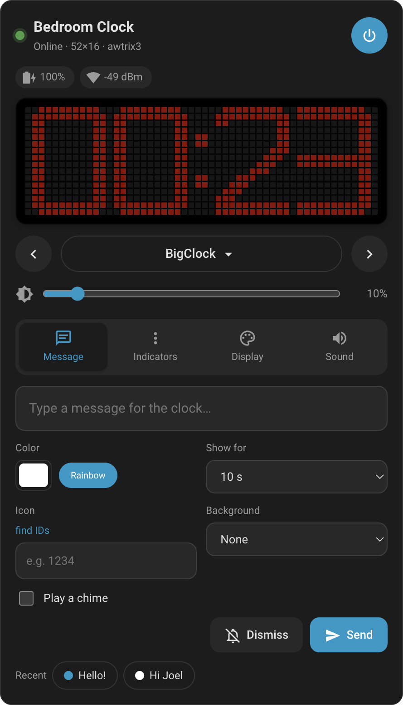
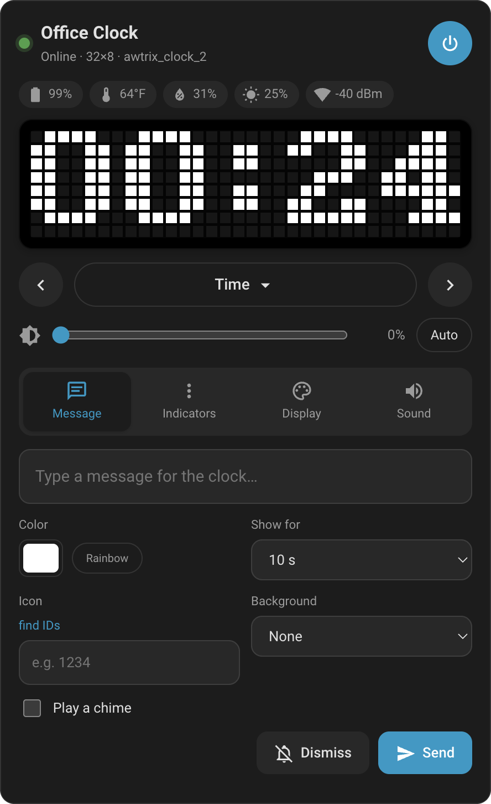

# AWTRIX NG Card

A Home Assistant dashboard card for **AWTRIX NG pixel clocks** (Blueforcer firmware 1.2+, e.g. Ulanzi TC001 / TC002): a live view of the display and full control of one clock.

<p align="center">
  
  
</p>

Everything goes through **MQTT**, the same way Blueforcer's own Home Assistant guide works. State is read from `<prefix>/state/...`, and commands go out with `mqtt.publish` to `<prefix>/cmd/...`.

## Requirements

- Home Assistant with the **MQTT integration** set up.
- Each clock running AWTRIX NG with MQTT on. Turn on **HA discovery**, so the clock's "MQTT prefix" sensor exists.
- **An admin user for live state.** Home Assistant only lets admins listen to MQTT topics. Other users can still use the buttons, but the card shows a warning and no live data.

## Install

### Home Assistant Marketplace

[](https://my.home-assistant.io/redirect/hacs_repository/?owner=joeladam518&repository=homeassistant-awtrix-ng-card&category=plugin)

1. Open **Marketplace** and search for **AWTRIX NG Card**.
2. Install it, then reload the browser.

#### Custom repository

If the card doesn't show up in the search, add it as a custom repository:

1. Open **Marketplace** and choose **⋮ → Custom repositories**.
2. Add `https://github.com/joeladam518/homeassistant-awtrix-ng-card` with the type **Dashboard**.
3. Find **AWTRIX NG Card** and install it, then reload the browser.

### By hand

1. Download `awtrix-ng-card.js` from the [latest release](https://github.com/joeladam518/homeassistant-awtrix-ng-card/releases/latest) into `/config/www/`.
2. Go to **Settings → Dashboards → ⋮ → Resources → Add resource**:
   - URL: `/local/awtrix-ng-card.js?v=2.1.2`
   - Type: **JavaScript module**
3. Hard-refresh the browser. In the phone app, use **Settings → Companion app → Debugging → Reset frontend cache**.

When you update, change the `?v=` number so browsers load the new file.

## Features

- **A live view** of what the clock is showing, including your messages, indicators and power state.
- **Status chips** for battery, temperature, humidity, ambient light and Wi-Fi.
- **Power**, **brightness** (plus Auto if the clock has a light sensor), and **previous / next / jump to app**.
- **Message:** colour or rainbow text, an icon, how long it stays (or until dismissed), an animated background and an optional chime. Your last 5 messages are kept for one-tap resend.
- **Indicators:** the three status dots on the right edge, each with a colour and solid, blink or pulse mode.
- **Display:** auto-rotate, time per app, transition effect and speed, default text colour, uppercase, weather overlay, mood light, a link to the clock's web page, and reboot.
- **Sound:** volume sliders, a test chime and stop. On the TC002 you also get internet radio and speech.

```yaml
type: custom:awtrix-ng-card
prefix: awtrix_clock_1 # required: the clock's MQTT prefix
name: Kitchen clock # optional, defaults to the clock's hostname
preview: true # live display mirror (default true)
preview_interval: 2000 # ms between preview frames (default 2000, min 500)
apps: [Time, Date] # optional extra entries for the app picker
```

There's a visual editor that lists the clocks Home Assistant found. To find a prefix by hand, open **Settings → Devices & services → MQTT**, then the clock's device page, and look for the **MQTT prefix** sensor.

## Using the clocks from automations

The card is for hands-on control. Automations can send to the same MQTT topics:

```yaml
action: mqtt.publish
data:
  topic: awtrix_clock_1/cmd/notify
  payload: '{"text":"Washer done","textColor":"#00FF00","icon":"1234","durationMs":10000}'
```

Useful topics: `cmd/notify`, `cmd/notify/dismiss`, `cmd/indicators/1` (2, 3), `cmd/apps/switch`, `cmd/settings`, `cmd/display` and `cmd/audio/play`. The full list is in the [AWTRIX NG docs](https://blueforcer.github.io/awtrix-ng/). Icon IDs are at <https://awtrix.de/icons/>.

## Good to know

- **Live preview traffic.** The preview asks the clock for a frame every 2 seconds, but only while the card is on screen and the browser tab is visible. Set `preview: false` or a bigger `preview_interval` for less traffic.
- **The app picker** gets the full app list from the clock's web API when your browser can reach the clock directly, as it can on your home network. Over remote HTTPS access it can't, so it lists the apps it has seen so far.

## Troubleshooting

| Problem                                        | Fix                                                                                    |
| ---------------------------------------------- | -------------------------------------------------------------------------------------- |
| "Custom element doesn't exist: awtrix-ng-card" | The resource isn't loaded. Check the install steps, then hard-refresh.                 |
| "Live state needs an admin user"               | Log in as an admin, or ask an admin to use the card.                                   |
| The card says the clock is offline             | The clock isn't connected to the MQTT broker. Check its MQTT settings on its web page. |
| Preview is blank but the clock works           | Wait a few seconds after the page opens, and check `preview` isn't `false`.            |
| Brightness slider snaps back                   | The clock is on Auto brightness. Tap **Auto** to switch to manual.                     |

## Develop

Needs Node 22+.

```sh
npm install
npm run watch   # rebuild dist/awtrix-ng-card.js on every change
npm run check   # typecheck, lint, format check, build, tests (what CI runs)
npm run fmt     # format everything
```

- **Code:** TypeScript + [Preact](https://preactjs.com) function components in `src/` (`.tsx`), styles in `src/*.css` (PostCSS), built with [rolldown](https://rolldown.rs) into one file with Preact included.
- **Layout:** `clock-card.tsx` with its tabs in `panels/`, plus `screen.ts` and `use-clock.ts`. The MQTT and message helpers and `awtrixCss` come from the shared helpers.
- **Shared helpers** come from [`homeassistant-ui-shared`](https://github.com/joeladam518/homeassistant-ui-shared), installed straight from GitHub by tag. No token needed.

**Releasing:** run `npm version <patch|minor|major>`, push with tags, then publish a GitHub release for the new `v…` tag. CI builds the card and attaches `awtrix-ng-card.js` to the release, which is what the Marketplace installs.

## License

MIT
